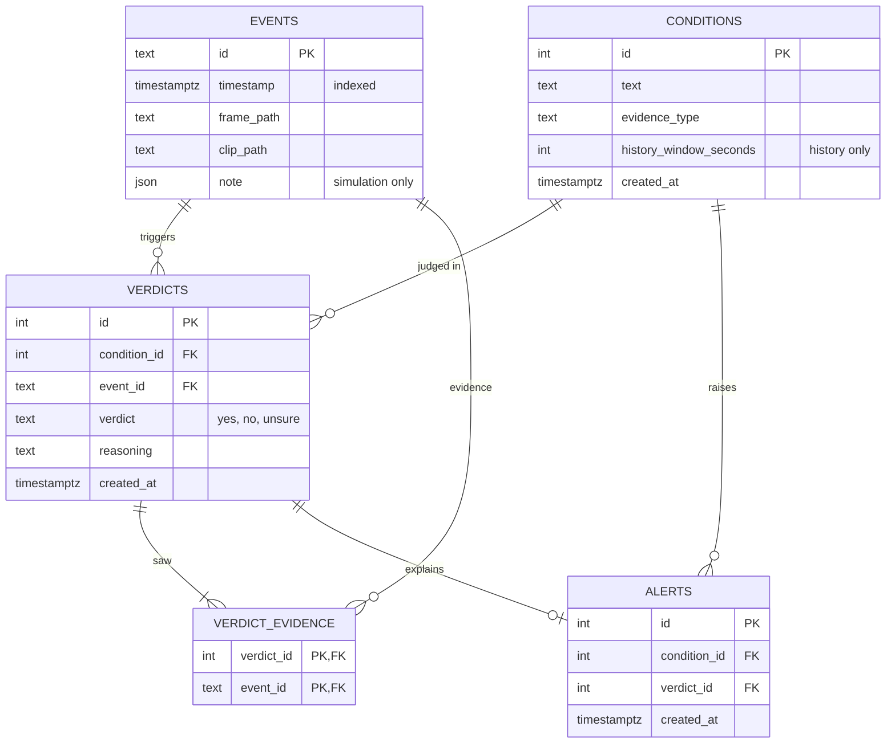

# Design note

A Dockerized prototype of an analytics backend that checks free-text user alert conditions ("alert me if someone loiters in front of the embassy") against CCTV camera events. The ~27B Qwen vision-language model (VLM) is mocked behind an interface. The README describes the data flow and has the system diagram; [production-notes.md](production-notes.md) covers what would change in production.

## Design approach: where the VLM's job ends

The main challenge of the task is deciding what the VLM should do and what deterministic code should do. A VLM can return an answer for arbitrary input, and that is what makes free-text conditions possible at all. But its output is hard to test, trace and reproduce. Deterministic code is reliable and traceable, but it can't interpret a sentence or an image.

- **The VLM does the two jobs that need language and vision understanding.** It classifies each condition once, at creation, deciding which evidence the condition needs. For every event, it judges whether the condition holds on the evidence it is handed, returning `yes`, `no` or `unsure` with its reasoning.
- **Deterministic code does everything around those two jobs.** It decides which events and frames make up the evidence, when a condition is evaluated, what is stored, and when a `yes` becomes an alert.

As a result, every verdict can be traced to the exact events the model saw, the number of model calls per event is fixed, and the whole pipeline can be tested with the model mocked. The cost is flexibility: the evidence types are a fixed set chosen by code. Letting the model gather its own evidence (an agentic loop) is the other end of the spectrum. It was considered and rejected (see below).

## Components

| Component | Where | Responsibility |
| --- | --- | --- |
| API | `app/api.py` | Conditions, event ingestion, verdicts and alerts. Swagger at `/docs` is the "simple UI". |
| Queue + loop | `app/main.py` | In-process FIFO queue; each event is processed in a worker thread, one at a time, so a slow VLM call doesn't block the API. |
| Event processing | `app/processing.py` | For every condition: gather context, call the VLM, store the verdict, alert on `yes` with dedup. |
| Context gatherer | `app/context.py` | Deterministic: turns (event, condition spec) into the evidence the VLM sees. |
| Condition service | `app/conditions.py` | Creates a condition after asking the VLM once for its spec. |
| VLM interface + `MockVLM` | `app/vlm.py` | `classify_condition(text) -> ConditionSpec`, `evaluate(text, context) -> verdict + reasoning`. |
| Repositories | `app/repositories/` | Interfaces with in-memory (unit tests) and Postgres implementations. |
| Demo | `app/demo.py` | Six scripted scenarios behind `POST /demo/{case}`, also used by the end-to-end tests. |

## Key decisions

- **Deterministic context selection; the VLM only judges.** The model never asks for more evidence, which keeps the flow testable and the inference calls per event fixed. *Rejected:* an agentic loop where the VLM fetches events and clips with tools.
- **Conditions classified once, at creation.** The evidence a condition needs doesn't change between events, so the spec is computed once and stored. *Rejected:* an LLM call per event to choose evidence.
- **Three evidence types:** `FRAME` (trigger frame), `CLIP` (frame and clip) and `HISTORY` (the trigger frames of all events in a window, oldest first). The task's "frames before the event" became earlier events' frames, because loitering needs earlier events, not earlier frames of one clip. *Rejected:* letting the user pick the evidence type, which weakens the natural-language idea.
- **Fixed history window instead of episodes.** The window is part of the spec (120 s for loitering, 60 s for package-left). *Rejected:* grouping events into episodes by gaps, which needs a threshold and more state.
- **Stateless re-evaluation.** Every event re-evaluates every condition over fresh history from the database, so there is no pending state. An `unsure` is stored; a later event may decide it over the longer history. *Rejected:* waiting for more events or requesting more frames after an `unsure`.
- **One verdict per (event, condition)**, with the ids of every event the VLM saw (`verdict_evidence`), which is what a human reviewing an `unsure` would need. An alert links to one verdict.
- **Dedup by a fixed window.** A `yes` at most 10 s after the previous `yes` for the same condition continues the same situation: the verdict is stored, but no new alert is raised. Any longer gap alerts again. 10 s is a fixed demo setting.
- **Single camera**, so there is no `camera_id`, and an in-process queue rather than a broker.

## Mock strategy

`MockVLM` never reads pixels. Each event carries a `SceneNote` describing what is visible: `people` (ids, standing in for re-identification), `objects`, and `observations` (keyword -> yes/no/unsure). One rule table in `app/vlm.py` maps condition keywords to both the spec and the evaluator, so classification and evaluation can't disagree. The first match wins:

| Keywords | Spec | Evaluator |
| --- | --- | --- |
| loiter, hanging around, lingers | `HISTORY`, 120 s | the same person in at least 3 consecutive frames ending at the current one, with no gap over 20 s: `yes`; present but not long enough: `unsure`; nobody in the current frame: `no` |
| package, parcel, left behind | `HISTORY`, 60 s | a person seen with the package earlier is gone from the current frame: `yes`; no package, or the package with a person still there: `no`; a package but no frame shows anyone with it: `unsure` |
| flee, run, fight, fall | `CLIP` | the current event's observation whose key appears in the condition text; none: `no` |
| anything else | `FRAME` | the same observation lookup |

For the two history rules, the verdict comes out of the gathered context, not out of a script. Loitering goes `unsure`, `unsure`, `yes` as the history grows. The package case becomes `yes` only once an earlier event shows who walked away, and stays `unsure` when no event shows anyone with the package.

## Data model

Tables are created at startup; there are no migrations or deletes.
