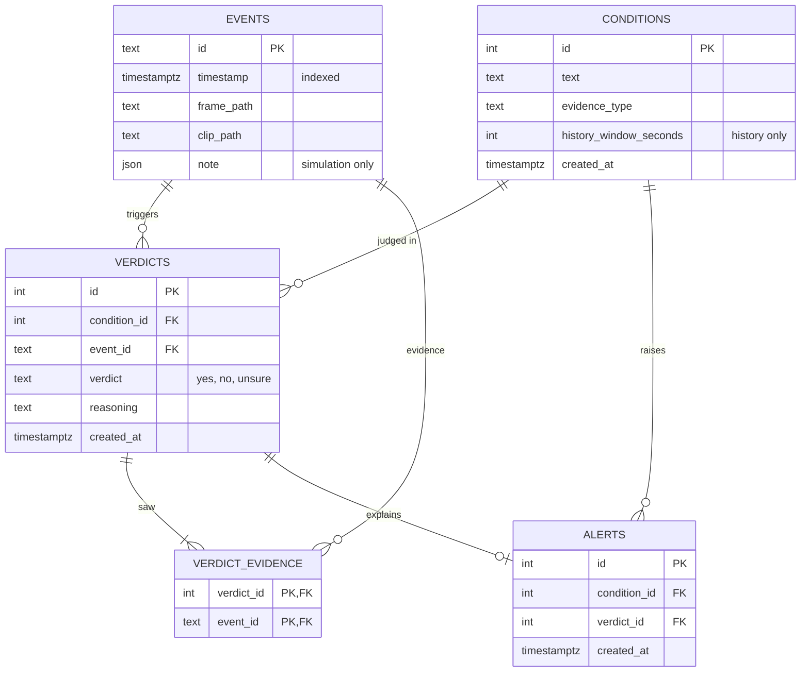

# Design note

A Dockerized prototype of an analytics backend that checks free-text user alert conditions ("alert me if someone loiters in front of the embassy") against CCTV camera events. The camera's built-in detector fires an event with a trigger frame and a 10 s clip, and re-fires about every 10 s while a situation persists. The ~27B Qwen vision-language model (VLM) is mocked behind an interface. What would change in production is in [production-notes.md](production-notes.md); this note covers what was built and why.

## Design approach: where the VLM's job ends

The main challenge of the task is deciding what the VLM should do and what deterministic code should do. A VLM can return an answer for arbitrary input, and that is what makes free-text conditions possible at all. But its output is hard to test, trace and reproduce. Deterministic code is reliable and traceable, but it can't interpret a sentence or an image.

The split:

- **The VLM does the two jobs that need language and vision understanding.** It classifies each user condition once, when the condition is created, deciding which evidence the condition needs. Then, for every event, it judges whether the condition holds on the evidence it is handed, returning `yes`, `no` or `unsure` with its reasoning.
- **Deterministic code does everything around those two jobs.** It decides which events and frames make up the evidence, when a condition is evaluated, what is stored, and when a `yes` becomes an alert.

As a result, every verdict can be traced to the exact events the model saw (`verdict_evidence`), and the number of model calls per event is fixed. The whole pipeline can also be tested with the model mocked. The cost is flexibility: the evidence types are a fixed set chosen by code. Letting the model gather its own evidence (an agentic loop) is the other end of the spectrum. It was considered and rejected; see the key decisions and the production notes.

## 1. Components

| Component | Where | Responsibility |
| --- | --- | --- |
| API | `app/api.py` | `POST/GET /conditions`, `POST /events` (202; 409 on a duplicate id), `GET /verdicts`, `GET /alerts`. Swagger at `/docs` is the "simple UI". |
| Event queue + loop | `app/main.py` | In-process `queue.Queue`, drained in arrival order by an asyncio task that polls every 200 ms. Each event is handled in a worker thread (`asyncio.to_thread`) so a slow VLM call does not block the API. One event at a time; a failing event is logged and skipped. |
| Event processing | `app/processing.py` | `process_event`: for every condition, gather context, call the VLM, store the verdict, raise an alert on `yes` unless it continues a recent one. |
| Context gatherer | `app/context.py` | Deterministic. Turns (event, condition spec) into the evidence the VLM sees. |
| Condition service | `app/conditions.py` | Creates a condition after asking the VLM once for its spec. |
| VLM interface + `MockVLM` | `app/vlm.py` | `classify_condition(text) -> ConditionSpec`, `evaluate(text, context) -> yes/no/unsure + reasoning`. |
| Repositories | `app/repositories/` | Interfaces plus in-memory (unit tests) and SQLAlchemy/Postgres implementations. |
| Demo | `app/demo.py` | Six scripted scenarios, run through the real pipeline by `POST /demo/{case}` and by the e2e tests. |

The camera backend is simulated by `POST /events`. The alert service is simulated by a log line.

## 2. Data flow

**Condition creation.** `POST /conditions {text}` -> `ConditionService` calls `vlm.classify_condition(text)` once -> the condition and its spec (`evidence_type`, `history_window_seconds`) are stored. Conditions apply from the next event on; nothing is re-evaluated retroactively.

**Event processing.**

1. `POST /events` stores the event and queues it (202).
2. The loop takes the oldest event and loads all conditions. For each:
3. `ContextGatherer.gather` builds the `Context` from the spec: `FRAME` is the trigger frame; `CLIP` adds the clip; `HISTORY` is the trigger frames of every event with a timestamp in `[t - window, t]`, oldest first, the current event last. Later events are never read.
4. `vlm.evaluate(text, context)` returns `yes`, `no` or `unsure` with reasoning.
5. A verdict row is stored together with the ids of every event the VLM saw (`verdict_evidence`).
6. On `yes`, an alert row linked to the verdict is created and logged, unless the previous `yes` for the same condition was at most 10 s earlier by event time.

## 3. Key decisions

- **Deterministic context selection; the VLM only judges.** Code decides which frames and clips the model gets, and the model returns a verdict. It never asks for more evidence. This keeps the decision flow testable and the number of inference calls per event fixed. *Rejected:* an agentic loop where the VLM fetches events and clips with tools; it moves control flow into the model and multiplies calls on a local 27B model (see production notes).
- **Conditions classified once, at creation.** The evidence a condition needs does not change between events, so `classify_condition` runs once and the spec is stored. There is no separate "compiler" component; the VLM interface has the extra method. *Rejected:* an LLM call per event to choose evidence.
- **Three evidence types, chosen by the classifier.** `FRAME`, `CLIP`, `HISTORY`. The task's "frames before the event" is implemented as the trigger frames of previous events (`HISTORY`), because loitering needs earlier events, not earlier frames of one clip. The spec is only `evidence_type` plus `history_window_seconds` (required for `HISTORY`, forbidden otherwise). *Rejected:* a user-declared evidence type or a classifier-suggests/user-overrides hybrid, which weaken the natural-language idea.
- **Fixed history window instead of episodes.** The window is a number in the spec (120 s for loitering, 60 s for package-left in the mock). *Rejected:* grouping events into episodes by gaps, which needs a gap threshold and more state. The cost is that unrelated sightings inside one window share a context; the mock's loitering rule uses timestamps to separate them (`LOITER_MAX_GAP`, 20 s).
- **Stateless re-evaluation.** Every event re-evaluates every condition over fresh history from the database. History is already stored, so there is no pending or retry state. An `unsure` is only stored and logged; a later event may produce a definitive verdict over the longer history. *Rejected:* waiting for N more events or requesting more frames on `unsure`, because of the stored-pending-state complexity.
- **One verdict per (event, condition).** Each condition gets its own row, with its reasoning. `verdict_evidence` records which events the VLM saw, which is what a human reviewer of an `unsure` would need. *Rejected:* one row per event listing all conditions.
- **An alert links to one verdict.** The verdict carries the analytic info: triggering event, evidence events, reasoning. No alert-to-many-events table.
- **Dedup window.** A `yes` within 10 s (`ALERT_DEDUP_WINDOW`, inclusive, by event time) of the previous `yes` for the same condition is the same situation continuing: its verdict is stored, but no new alert. The window equals the camera re-fire interval, so a persisting situation alerts once and a gap longer than 10 s starts a new alert.
- **Single camera.** No `camera_id`; every condition is checked against every event.
- **In-process queue, worker thread.** A `queue.Queue` keeps arrival order, which temporal conditions need. The thread keeps the API responsive. No broker, since the prototype is a single process.
- **Not built:** relevance screening before full evaluation, so every condition is evaluated for every event (production notes).

## 4. Mock strategy

`MockVLM` never reads pixels. Each event carries a `SceneNote` describing what is visible: `people` (ids, a stand-in for re-identification), `objects`, and `observations` (keyword -> yes/no/unsure for frame and clip conditions). The pipeline still passes frame and clip paths as if the model were real.

One rule table in `app/vlm.py` maps condition keywords to both the `ConditionSpec` and the evaluator, so classification and evaluation cannot disagree. First match wins, multi-event rules first:

| Keywords | Spec | Evaluator |
| --- | --- | --- |
| loiter, hanging around, lingers | `HISTORY`, 120 s | the same person in at least 3 consecutive frames ending at the current one, with no gap over 20 s: `yes`; seen but not long enough: `unsure`; nobody in the current frame: `no` |
| package, parcel, left behind | `HISTORY`, 60 s | package in the current frame and a person seen with it earlier is gone: `yes`; that person still there: `no`; package but nobody ever seen with it: `unsure` |
| flee, run, fight, fall | `CLIP` | the current event's observation for a keyword in the condition text |
| anything else | `FRAME` | the same observation lookup |

The verdicts of the history conditions come out of the context, not out of a script, so the demo cases arise from what the gatherer collects:

1. **Single frame** (`smoke`): one event, `observations={"smoke": yes}` -> `yes`, alert.
2. **Several events** (`multi-event`, `package-left`): the same person in events at 0, 10, 20 s gives `unsure`, `unsure`, `yes` as the history grows. For the package, the person with the package gives `no`; when the next event shows the package alone, the history shows who walked away: `yes`.
3. **Insufficient** (`insufficient`): a package is visible in every frame and nobody is, so nothing says who left it: `unsure`, no alert.
4. **Negative** (`negative`): the event fires with `fleeing: no` -> `no`, no alert.

A sixth case, `dedup`, shows the alert window. Scenarios are written so that no event produces a `yes` for another scenario's condition, and a test checks this.

## 5. Data model

Verdict evidence is returned oldest first. Tables are created at startup; there are no migrations or deletes.

## 6. Production

The simplifications a reviewer might otherwise read as mistakes (single camera, scene notes on the event, dedup window, unresolved `unsure`, English-only mock keywords, in-memory queue) and what replaces them are listed in [production-notes.md](production-notes.md), together with the alternatives worth revisiting (agentic retrieval, two-stage relevance screening) and known limitations (person re-identification).
