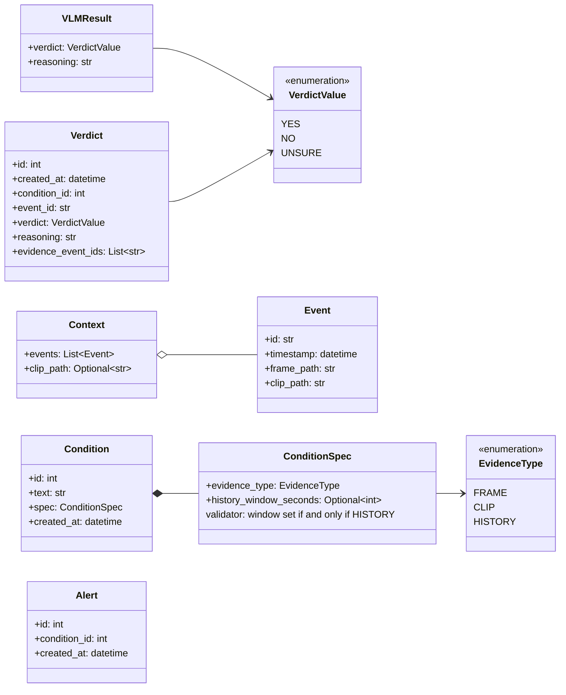
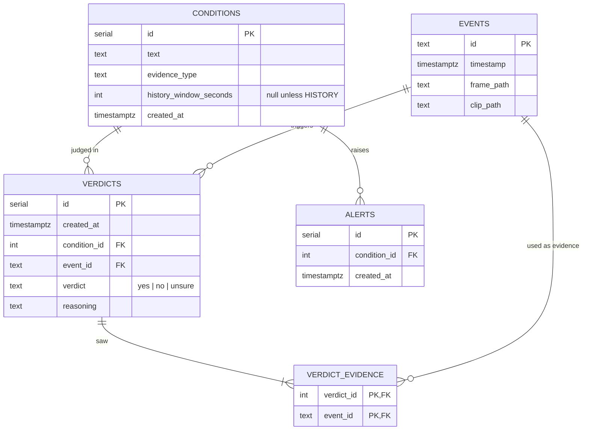
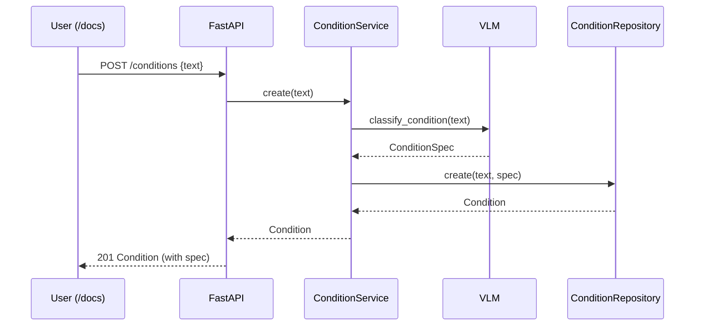
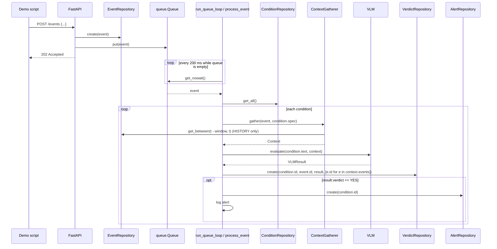

# Proposed classes and interfaces (for review)

Status: **draft for review, nothing implemented yet.** Based on the planning session of 2026-10-27, revision 2.
Decisions marked *(Claude's call)* were not explicitly discussed and are open to change.

## Decisions this reflects

- **Single camera.** No `camera_id` anywhere. A real system has many cameras and would also have to match conditions to cameras (production note).
- Evidence types: `FRAME` (trigger frame), `CLIP` (trigger frame + clip), `HISTORY` (trigger frames of all events in `[t - window, t]`, oldest first, current event included, no clips).
- Compiled spec = `evidence_type` + `history_window_seconds`. The window is required for `HISTORY` and forbidden for the other types (validated). No priority, no detector type, no episodes.
- No compiler: when a condition is created, `ConditionService.create` asks the VLM once (`classify_condition`) which evidence type it needs. The mock decides by keywords and defaults to `FRAME`.
- One verdict per (event, condition); `verdict_evidence` records every event the VLM saw (needed for human review of `unsure`).
- Every `yes` verdict creates an alert and logs it directly (no notifier class; dedup/cool-down parked). Alerts: `id, condition_id, created_at`.
- `unsure` is just logged and filterable via the API; production would flag it for human review.
- No media files; frame/clip paths are plain strings. Example events are hard-coded and posted to `POST /events`.
- One Postgres container for all tables; repositories behind interfaces with in-memory fakes for unit tests. All repositories use the same method names: `create`, `get`, `get_all`. No deletes: to start from scratch, drop the database.
- Events go into a standard-library `queue.Queue`; a plain background loop takes them out every 200 ms and processes them with module functions (no worker/processor classes).
- Mock VLM behaviour is parked: interface + empty stub only.

## 1. Domain model



- `Context.events` is ordered oldest first; the current event is always the last one. The VLM's frames are `[e.frame_path for e in events]`, and the verdict's evidence ids are `[e.id for e in events]`.
- Domain classes are Pydantic models, so the `ConditionSpec` rule is a `model_validator` and the same models can back the API *(Claude's call)*.

## 2. Components

```mermaid
classDiagram
    direction TB

    class ConditionService {
        -conditions: ConditionRepository
        -vlm: VLM
        +create(text: str) Condition
    }
    note for ConditionService "create() asks vlm.classify_condition(text)\nfor the spec, then stores the condition."

    class ContextGatherer {
        -events: EventRepository
        +gather(event: Event, spec: ConditionSpec) Context
    }

    class VLM {
        <<interface>>
        +classify_condition(condition_text: str) ConditionSpec
        +evaluate(condition_text: str, context: Context) VLMResult
    }
    class MockVLM {
        +classify_condition(condition_text: str) ConditionSpec
        +evaluate(condition_text: str, context: Context) VLMResult
    }
    note for MockVLM "classify_condition: keyword rules, default FRAME.\nevaluate: stub - behaviour parked.\nDocstring: in production the real VLM receives\nall context selected by deterministic code from\nthe condition's spec and only returns a verdict."
    VLM <|.. MockVLM

    class processing {
        <<module>>
        +process_event(event, conditions, gatherer, vlm, verdicts, alerts) List~Verdict~
        +run_queue_loop(events: queue.Queue~Event~, handle, poll_interval=0.2) None
    }
    note for processing "Plain functions, no classes.\nrun_queue_loop: get_nowait(); if empty, sleep 200 ms;\notherwise handle(event). A failing event is logged and skipped.\nmain.py creates the queue and starts the loop as a\nbackground task in the FastAPI lifespan; cancelling stops it."

    ConditionService --> ConditionRepository
    ConditionService --> VLM
    ContextGatherer --> EventRepository
    processing --> ContextGatherer
    processing --> VLM
    processing --> ConditionRepository
    processing --> VerdictRepository
    processing --> AlertRepository

    class ConditionRepository {
        <<interface>>
    }
    class EventRepository {
        <<interface>>
    }
    class VerdictRepository {
        <<interface>>
    }
    class AlertRepository {
        <<interface>>
    }
```



`process_event`, per condition: `gather` → `vlm.evaluate` → `verdicts.create(...)` → if `YES`: `alerts.create(condition.id)` and `logger.info(...)` the alert.

### ContextGatherer rules

| `evidence_type` | `Context.events` | `Context.clip_path` |
| --- | --- | --- |
| FRAME | `[event]` | `None` |
| CLIP | `[event]` | `event.clip_path` |
| HISTORY | `events.get_between(t - window, t)`, oldest first | `None` |

`t` is the current event's timestamp. The upper bound is inclusive, so the current event is always part of the history and later events are never read.

## 3. Repositories

```mermaid
classDiagram
    direction TB

    class EventRepository {
        <<interface>>
        +create(event: Event) Event
        +get(event_id: str) Optional~Event~
        +get_all() List~Event~
        +get_between(start: datetime, end: datetime) List~Event~
    }
    class ConditionRepository {
        <<interface>>
        +create(text: str, spec: ConditionSpec) Condition
        +get(condition_id: int) Optional~Condition~
        +get_all() List~Condition~
    }
    class VerdictRepository {
        <<interface>>
        +create(condition_id: int, event_id: str, result: VLMResult, evidence_event_ids: List~str~) Verdict
        +get(verdict_id: int) Optional~Verdict~
        +get_all(condition_id: Optional~int~, verdict: Optional~VerdictValue~) List~Verdict~
    }
    class AlertRepository {
        <<interface>>
        +create(condition_id: int) Alert
        +get(alert_id: int) Optional~Alert~
        +get_all() List~Alert~
    }

    class SqlEventRepository
    class SqlConditionRepository
    class SqlVerdictRepository
    class SqlAlertRepository
    class InMemoryEventRepository
    class InMemoryConditionRepository
    class InMemoryVerdictRepository
    class InMemoryAlertRepository

    EventRepository <|.. SqlEventRepository
    EventRepository <|.. InMemoryEventRepository
    ConditionRepository <|.. SqlConditionRepository
    ConditionRepository <|.. InMemoryConditionRepository
    VerdictRepository <|.. SqlVerdictRepository
    VerdictRepository <|.. InMemoryVerdictRepository
    AlertRepository <|.. SqlAlertRepository
    AlertRepository <|.. InMemoryAlertRepository
```



- Naming: `create` / `get(id)` / `get_all(filters)` on every repository. `get_between` is the one extra, for the history query.
- `get_between` returns events ordered by `timestamp` ascending, `start <= timestamp <= end`.
- `VerdictRepository.create` writes the `verdicts` row and its `verdict_evidence` rows in one transaction. Evidence is returned oldest first; the SQL repository sorts it by event timestamp (then id).

## 4. Database schema (one Postgres container)



Indexes *(Claude's call)*: `events (timestamp)` for the history query; `verdicts (condition_id)` and `verdicts (verdict)` for the `/verdicts` filters.

## 5. HTTP API (FastAPI)

| Method | Path | Body / query | Response |
| --- | --- | --- | --- |
| POST | `/conditions` | `{text}` | `201 Condition` incl. compiled spec |
| GET | `/conditions` | – | `List[Condition]` |
| POST | `/events` | `{id, timestamp, frame_path, clip_path}` | `202 Accepted` (stored + queued) |
| GET | `/verdicts` | `?condition_id=&verdict=` | `List[Verdict]` incl. `evidence_event_ids` |
| GET | `/alerts` | – | `List[Alert]` |

The Swagger page at `/docs` is the "simple UI" for now.

## 6. Flows (not reviewed yet)

### Condition creation



### Event processing



## 7. Proposed layout *(Claude's call)*

```
app/
  domain.py          # enums + Pydantic models above
  conditions.py      # ConditionService
  context.py         # ContextGatherer
  vlm.py             # VLM, MockVLM (classify_condition by keywords; evaluate is a stub)
  processing.py      # process_event, run_queue_loop
  repositories/
    base.py          # the four repository interfaces
    sql.py           # SQLAlchemy tables + Sql*Repository
    memory.py        # InMemory*Repository
  api.py             # routes
  main.py            # wiring: creates the queue, lifespan starts/cancels the queue loop
demo/
  scenarios.py       # hard-coded conditions + events (shared with tests)
  run_demo.py        # posts scenarios to the API, prints verdicts/alerts
tests/
docker-compose.yml
pyproject.toml
```

## Still parked

- Mock VLM behaviour (and whether the spec needs a `label` for it).
- Alert dedup / per-condition cool-down after an alert.
- Conditions needing frames far apart in time without the events in between.
- What kind of UI is actually expected.
- Dockerfile vs. compose-only start.
